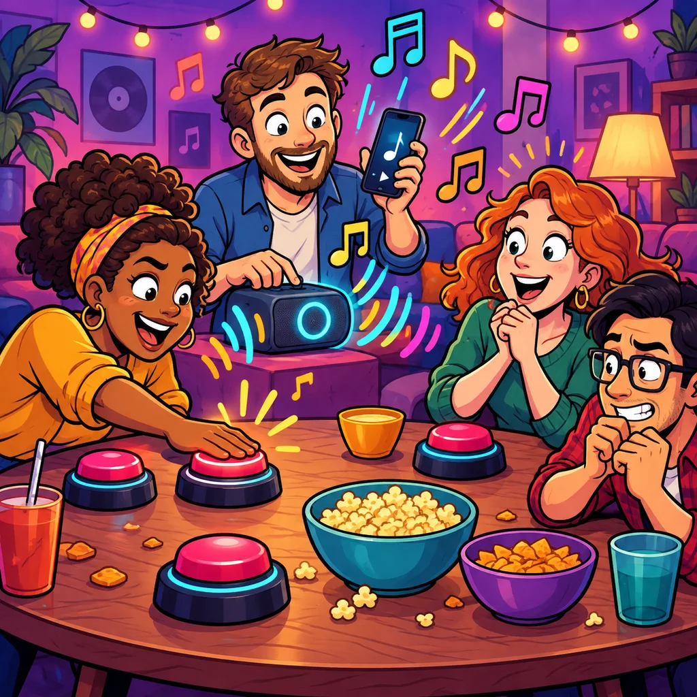

# Hit-Buzzer – Spielkonzept und Umsetzungsplan

Stand: 1. November 2026. Arbeitstitel **Hit-Buzzer**. Dieses Dokument beschreibt Spielregel, Umsetzung und Abnahme. Der Spielmodus ist im Entwurf implementiert. CI und ein lokaler Einzel-/Teamablauf in der Vercel-Vorschau sind geprüft; Mehrgeräte-, echte Geräte- und Produktionsabnahme stehen noch aus.

## 1. Versprechen und Grenzen

Hit-Buzzer ist ein schnelles Song-Erkennungsspiel. Ein 30-Sekunden-Ausschnitt läuft hörbar auf dem Host-Gerät oder bei verbundenem Fernseher auf dem TV; der Host hält dann die Zeit mit stummem Audio weiter. Jede spielende Person hat einen Buzzer. Wer zuerst buzzert, sagt **Interpret und Titel** laut. Der Host bestätigt die Antwort. Eine richtige Antwort belohnt eine schnelle Reaktion; eine falsche kostet Punkte und lässt die übrigen Spieler wieder zu.

Das Spiel braucht keine Jahreszahlen, Zeitlinie, Albumcover, Spotify-Premium-Mitgliedschaft oder Texterkennung. Es verwendet die vorhandenen 30-Sekunden-Vorschauen und denselben gepflegten Songbestand wie Ohrwurm. Der Host trifft die Entscheidung bei Schreibvarianten, Features, Coverversionen und unklarer Aussprache.

## 2. Entscheidungen für Version 1

| Regel | Vorgabe | Einstellbar |
| --- | --- | --- |
| Ziel | Höchste Punktzahl nach 15 Songs | 5–30 Runden oder erster zu 500/750/1000 Punkten |
| Musikfenster | Maximal 30 Sekunden pro Song | Nein, durch Vorschau begrenzt |
| Antwortfenster | 8 Sekunden ab bestätigtem Buzz | 5/8/12 Sekunden |
| Richtige Antwort | Interpret **und** Titel; Host bestätigt | Keine automatische Prüfung |
| Punkte | +100 bis +40, abhängig vom Buzz-Zeitpunkt | „Konstant“ mit +100 als barrierearme Option |
| Falsche/keine Antwort | −20 Punkte, genau ein Versuch pro Spieler oder Team und Song | −10/−20/−30 oder ohne Abzug |
| Punktestand | Darf negativ werden | Nein |
| Gleichstand | Gemeinsamer Sieg | Stichrunde als spätere Variante |
| Wiedergabe | Ohne TV spielt das Host-Gerät; bei verbundenem TV spielt der Fernseher und der Host hält den Audiotakt stumm weiter | Keine doppelte hörbare Wiedergabe |

Der vorgeschlagene Zeitwert lautet `max(40, 100 - 2 × floor(abgelaufene Sekunden))`. Maßgeblich ist der vom Host angenommene Buzz-Zeitpunkt, **nicht** die Dauer der mündlichen Antwort. Nach Buzz werden Musik und 30-Sekunden-Uhr eingefroren. Bei einer falschen Antwort laufen beide an derselben Stelle weiter; bereits gesperrte Spieler dürfen in dieser Runde nicht erneut buzzern. Bei richtiger Antwort endet der Song sofort. Erreicht jemand das Punktziel durch einen bestätigten Treffer, endet das Spiel nach der Auflösung dieses Songs.

Beispiel: Buzz nach 7,8 Sekunden ergibt +86 Punkte. Falsche Antwort kostet 20, sperrt nur diese Person beziehungsweise ihr Team und setzt den Song bei 7,8 Sekunden fort. Ein anderer Spieler buzzert bei 11,2 Sekunden und erhält bei richtiger Antwort +78. Die 8 Sekunden Antwortzeit verbrauchen keine Musikzeit.

## 3. Geräte- und Teammodelle

### Eigenes Handy / Joystick-Modus

- Der Host eröffnet wie bei Party Play eine Lobby mit Code und QR. Die Spieler kommen über ihr eigenes Handy hinein. Die Spielerkarte zeigt den eigenen Namen, Teamfarbe, Punktestand, Verbindungsstatus und einen dauerhaft erreichbaren großen Buzzer.
- **Jedes Handy hat seinen eigenen Buzzer**, auch wenn mehrere Personen im selben Team spielen. Ein Buzz ist immer einer eindeutig zugeordneten Person zuordenbar. Der Team-Punktestand wird separat geführt.
- Ein Spieler ohne eigenes Handy kann als Platz auf dem Host-Handy teilnehmen. Anders als bei Pixeljagd hat **jeder solche Platz einen eigenen sichtbaren Buzzer** auf dem Host-Gerät; ein geteiltes Handy bedeutet nicht automatisch nur einen Versuch für alle.
- Im Teammodus sperrt eine falsche Antwort das gesamte Team für diesen Song, weil sonst große Teams mehr Versuche bekämen. Im Einzelmodus sperrt sie nur den Spieler. Mehrere Teammitglieder dürfen bis zum ersten akzeptierten Buzz jeweils drücken; der erste Buzz reserviert den Teamversuch.
- Der Host kann Moderator sein, ohne mitzuspielen. Spielt der Host mit, erscheint sein eigener Buzzer neben den Host-Steuerelementen; ein versehentliches Tippen auf „Richtig“ darf keinen eigenen Buzz auslösen.
- Die Host-Ansicht zeigt alle Plätze, Verbindungen und Buzz-Eingänge. Jeder Gast sieht den gleichen Phasenstand, jedoch keine Lösung und keine anderen privaten Eingaben.

### Ein Gerät / Pass & Play

- Auf dem Host-Handy erscheint eine Buzzer-Fläche mit **einem großen, farblich getrennten Button pro Spieler**. Im Teammodus gehören die individuellen Buttons zum gemeinsamen Teamstand.
- Die Buttons bleiben während des Hörens gleichzeitig erreichbar. Für mehr als vier Plätze wird die Fläche in zwei Spalten oder eine scrollbare Liste mit feststehender Musiksteuerung aufgeteilt; Mindestzielgröße 48 × 48 CSS-Pixel, besser deutlich größer.
- Der Host bewertet nach einem Buzz. Ist der Host zugleich Spieler, kann die Gruppe einen neutralen Moderator bestimmen; bei Self-Play bleibt die Antwortprüfung bewusst manuell und transparent.
- Beim falschen Versuch verschwindet nur der gesperrte Button. Alle anderen bleiben sofort aktiv, sobald der Host „Falsch“ bestätigt und die Vorschau wieder läuft.

### Teams

- Die Party-Lobby liefert Namen, Avatare und Farben der Mitglieder. Die Zuordnung zu Team A oder B erfolgt im Spiel-Setup; auch außerhalb der Party-Lobby bietet das Setup Einzelspieler und Teams an.
- Punkte gehören dem Team. Host und TV zeigen den Teamstand; beim Buzz wird das tatsächliche Mitglied genannt. Ein dauerhafter Buzz-Verlauf ist noch nicht umgesetzt.
- Gleichzeitige Buzzes aus demselben Team ergeben nur einen Teamversuch. Der zuerst angenommene Buzz wird angezeigt.

## 4. Ablauf einer Partie

1. **Setup:** Spielmodus, Runden-/Punktziel, Strafpunkte, Antwortfrist, Genre und Einzel-/Teamwertung wählen. Standardwerte erlauben einen Start mit einem Schritt. Die verfügbare Songzahl wird beim Start geprüft und die Rundenzahl auf den Pool begrenzt.
2. **Lobby:** Code/QR, Host und Gäste, Teams und kontrollierte Plätze werden gezeigt. Erst der Host startet. Fehlende oder getrennte Teilnehmer sind klar markiert; Start ist erst ab zwei aktiven Spielplätzen möglich.
3. **Song vorbereiten:** Der Host zieht genau eine bislang in dieser Partie ungespielte Song-ID. Die Vorschau wird vor dem Start geladen. Fehlt der Clip, kann der Host den Song ohne Punkteabzug und ohne Rundenverbrauch überspringen. Im Admin-Bereich kann er Songs unabhängig von einer Partie probehören.
4. **Start:** Der Host startet den Audiotakt. Buzzer öffnen erst, wenn `audio.play()` auf dem Host erfolgreich war. Bei verbundenem TV ist der Host stumm; der Fernseher erhält die Vorschau und spielt sie hörbar. Ein gemeinsamer 3–2–1-Countdown ist für eine spätere Version vorgemerkt, da ein zeitversetzter Audio-Start auf iOS sonst die Wiedergabe blockieren kann.
5. **Buzz:** Das erste gültige Signal reserviert den Antwortversuch. Alle Geräte zeigen „[Name] ist dran“; Musik und Rundenuhr pausieren. Der Host hört die gesprochene Antwort und hat „Richtig“, „Falsch“, „Nicht wertbar“ sowie „Rückgängig“ nach einer Wertung.
6. **Auflösung:** Richtig beendet den Song und zeigt Titel, Interpret, Punkte und neue Tabelle. Falsch zieht Punkte ab, sperrt den Spieler/das Team und öffnet die übrigen Buzzer wieder. „Nicht wertbar“ gibt den Buzzer ohne Abzug frei, etwa bei Verbindungsfehler oder Fehlbedienung.
7. **Zeit abgelaufen:** Bei 30 Sekunden ohne Treffer endet der Song punktlos. Wenn ein gültiger Buzz unmittelbar vor Ablauf angenommen wurde, darf die begonnene Antwortfrist zu Ende laufen.
8. **Nächster Song:** Host bestätigt; die neue Runde bekommt eine neue ID und einen anderen Song. Nach 15 Songs oder Erreichen des Punktziels folgt die Rangliste mit „Noch einmal“ und frischer Punktzahl.

## 5. Zustände und Datenvertrag

`setup/Lobby → loading → listening ↔ paused → answering → listening/roundResult → gameResult`.

| Feld | Bedeutung |
| --- | --- |
| `matchId`, `roundId`, `revision` | Neue Partie, eindeutiger Songversuch und monotoner Zustand; alte Aktionen verwerfen |
| `songId` | Nur Host; nie an Gäste oder TV vor Reveal schicken |
| `previewUrl` | Host und TV-Audioausgabe; Gastoberflächen zeigen die URL nicht. Der bestehende TV-Raumkanal ist für Raumteilnehmer technisch beobachtbar. |
| `phase`, `elapsedMs` | Synchronisierte Anzeige; Host bleibt Zeitautorität |
| `claim` | Spieler-ID, Punkte zum Buzz-Zeitpunkt und Antwortfrist |
| `players[].locked` | In diesem Song ausgeschlossene Spieler; bei Teams alle Mitglieder |
| `players[].score`, `revision` | Wertung und Versionsfolge; die letzte Wertung ist für Rückgängig vorgehalten |
| `claim.expiresAt` | Frist nach Buzz; Countdown pausiert die Vorschau |

Gäste senden nur `buzz` mit `matchId`, `roundId`, `actionId` und Platz-ID. Der Raumtransport ergänzt den Absender. Der Host verarbeitet nur einen Eingang, der zur aktuellen Runde passt und dessen Absender den behaupteten Platz tatsächlich kontrolliert. Ein wiederholtes `actionId` ändert nichts. Punkte, Songwahl, Bewertung und Reveal bleiben lokale Host-Aktionen und werden als Zustand verteilt. Unterbricht die Verbindung während einer Antwort, verlängert der Host die Antwortfrist beim Wiederverbinden um die Ausfallzeit.

**Fairness:** Die erste beim Host gültig eingetroffene Buzz-Nachricht gewinnt. Geräteuhren dürfen die Reihenfolge nicht bestimmen, weil sie manipulierbar und unsynchron sind. Netzwerkverzögerung kann ein echtes Gleichzeitigkeitsergebnis verändern. Die UI soll daher keine Millisekunden-Rangliste behaupten; der Host kann ein offensichtlich falsches Ergebnis mit „Nicht wertbar“ aufheben. Ein transaktionaler Server-Buzz mit serverseitiger Reihenfolge ist eine spätere Option, falls reale Tests Host-Ankunft als unzureichend zeigen.

**Reconnect:** Die aktuelle öffentliche Momentaufnahme enthält Phase, verbleibende Vorschauzeit, Punkte, Sperren und derzeitigen Buzz. Wiederkehrende Gäste fordern den Host-Zustand erneut an. Bei Host-Verbindungsabbruch pausiert die Partie; kein Gast wird automatisch zum Host. Ein wiederkehrender Gast kann nur noch in der aktuellen offenen Hörphase buzzern. Verlassende Spieler werden aus der Buzz-Auswahl entfernt; ein aktiver Buzz dieser Person wird ohne Strafe freigegeben. Ein Host-„Undo“ rollt nur die letzte Entscheidung dieser Runde zurück und synchronisiert eine höhere `revision`.

## 6. Audio und Songbestand

- **Einzige Datenquelle:** `public.ohrwurm_songs` und der bestehende Ohrwurm-Codebestand. Hit-Buzzer bekommt **keine zweite Songtabelle und keinen Kopierjob**. Der Spielmodus ruft beim Start jeder neuen Partie den Adapter `src/games/hitbuzzer/song-pool.ts` auf; dieser verwendet denselben `loadExtraSongs(aktuelleSprache)`-Lader und `buildDeck()` wie Ohrwurm. Neu angelegte Songs erscheinen dadurch bei der nächsten Partie automatisch; laufende Partien behalten ihren eingefrorenen Deck.
- Dieselben `languages`-Zuordnungen, Aktivierung und Genre-Filter gelten. `base_id` ersetzt den statischen Grundsong, statt ihn zu duplizieren. Stabile IDs verhindern Doppelziehungen und erlauben eindeutige Reports.
- Vorschau: `Song.previewUrl` bevorzugen; andernfalls den vorhandenen `ohrwurm-preview`-Resolver mit Cache, Timeout und Retry verwenden. Kein zweites Streaming und kein Clip-Upload. Bei verbundenem TV erhält dieser den Vorschau-Link zur Wiedergabe; der Host spielt stumm weiter.
- Ein direkter Spotify-Link oder Suchlink nach dem Reveal bleibt eine spätere Ergänzung. Das ändert die In-Game-Wiedergabe nicht.
- Beim Start werden aktive Songs der aktuellen Sprache und des gewählten Genres geladen. Die Vorschau wird pro Song vorbereitet; ein fehlender Clip kann ohne Rundenverbrauch übersprungen werden. Eine Prüfung aller Clips vor Spielstart bleibt offen.
- **Deaktivierungs-Fallback:** Eine erfolgreiche Datenbankabfrage mit null aktiven Grundsongs wird als leere Liste übernommen; nur ein echter Abfragefehler nutzt den eingebauten Offline-Grundbestand. Dafür gibt es einen gezielten Songpool-Test.

## 7. Admin-Portal

Im Bereich **Admin → Spiele** stehen Hit-Buzzer und Ohrwurm in der Navigation der eigenen Spielbibliotheken; eine Hit-Buzzer-Karte zeigt Cover, Spiel-Link und Link zur gemeinsamen Songverwaltung. Derselbe `ohrwurm_songs`-Editor pflegt beide Spiele. Jahr bleibt ein Metadatenfeld für Ohrwurm, obwohl Hit-Buzzer es nicht wertet. Interpret, Titel, Land/Flagge, Genre, Sprachfassungen, Aktivierung, Vorschau und Spotify-URI werden nur einmal gepflegt.

Die Songverwaltung zeigt, ob ein direkter Clip-Link vorhanden ist oder der Resolver gebraucht wird; „Probehören“ testet die Wiedergabe, ohne eine Partie zu verbrauchen. Der Link ist im Editor pflegbar. Meldet der Host einen Song aus Hit-Buzzer, führen die Admin-Spielmeldungen über die Song-ID direkt zum gefilterten Eintrag. Eine aggregierte Fehlerquote und ein Bericht über übersprungene Songs sind noch nicht implementiert. Spielregeln wie Punkteziel und Strafpunkte gehören ins Match-Setup; Admin-Vorgaben duplizieren die Songbibliothek nicht.

## 8. Corporate Design und Erlebnisqualität

Hit-Buzzer ist visuell Teil von EventBliss Party Play. Die Grundlage ist `docs/party-play-design.md`. Die umgesetzten Spielansichten verwenden `GameStage`, `StagePanel`, Spielerfarben, `font-game` sowie `tvPanel` und `tvType`. Die folgenden Detailregeln sind zugleich Zielbild für die noch offene visuelle und gerätebezogene Abnahme.

| Gestaltung | Hit-Buzzer-Anwendung |
| --- | --- |
| Flächen | `#060810` als Bühne, `#0d0915` als Panel, `#16101f` als aktive Karte; keine flachen grauen Kästen |
| Akzente | `#df8eff` für Hauptaktionen, `#8ff5ff` für bereit/bestätigt, `#ff6b98` für Warnung/Strafe; Pink `#FF2E88` nur als Spielakzent am Buzzer |
| Radien | 28 px für Bühnenpanels, 20 px für Karten, volle Rundung für Status-Pills; gleicher Rhythmus auf Host, Handy und TV |
| Typografie | `font-game` für kurze Bühnenansagen; Fließtext in der bestehenden App-Schrift. Zahlen und Countdown mit `tabular-nums`; höchstens zwei Gewichte pro TV-Szene |
| Spieleridentität | Zimmer-/Lobby-Farbe folgt dem Spieler via `playerGlow`; auf Text und Status zusätzlich Name, Avatar, Form und Icon |
| Bild | Eigenständige gezeichnete Gruppenszene im Stil der vorhandenen Ohrwurm-, Pixeljagd- und GEBRÄU-Cover; kein fotorealistischer Neon-Buzzer |

**Cover:** Vier Freunde an einem Tisch und genau **ein** großer physischer Buzzer in der Tischmitte als gemeinsamer Blickfang. Ein Mensch greift zuerst danach; die Musikquelle steht beim Host. Handgezeichnete Konturen, ausdrucksstarke Figuren, violette EventBliss-Bühne und sparsame Pink-/Türkis-Akzente. Die Illustration zeigt das Spielgefühl; im Joystick-Modus erhält weiterhin jede Person ihren eigenen digitalen Buzzer auf dem jeweiligen Handy. Die App setzt „Hit-Buzzer“ als echten UI-Text über oder neben das Bild; im Bild selbst stehen keine Buchstaben. Datei: `public/images/games/hit-buzzer.webp`.

### 8.1 Informationshierarchie pro Bildschirm

| Phase | Spielerhandy | Host-Handy | TV |
| --- | --- | --- | --- |
| Bereit | Eigener Avatar, Team und großer Buzzer; „Warte auf den Song“ | Song vorbereiten, Lautstärkeprobe, Teilnehmerstatus | Runde, alle Avatare, „Gleich geht's los“ |
| Start | Buzzer bis zum Host-Audiostart gesperrt | Startstatus und Audio-Bereitschaft | Song wird vorbereitet |
| Hören | Ein dominanter Buzzer in der Daumenzone, darunter eigener Punktestand | Audio/30-s-Ring, lokale Plätze mit **je eigenem** Buzzer, sichere Juryzone noch verborgen | Songnummer und Ring, Rangliste in fester Seitenzone |
| Buzz angenommen | „Du bist dran“ mit eigenem Avatar und Antwortfrist; andere sehen „[Name] antwortet“ | Musik pausiert, Name groß, Juryaktionen getrennt von jedem Buzzer | Spotlight auf den Buzzenden; keinerlei Songtitel |
| Falsch | Eigener Platz „Für diesen Song gesperrt“; andere Buzzer werden wieder aktiv | −20 sichtbar, dann „Weiterhören“; keine zusätzliche Bestätigung nötig | Kurzer Punktabzug am richtigen Platz, Zeitring läuft weiter |
| Richtig/Ende | Lösung und eigene Punktänderung, dann ruhig warten | Titel/Interpret, kontrollierbarer nächster Song | Song-Reveal, neue Rangfolge und Moment für den Gewinner |
| Verbindung weg | Ruhiger Sperrzustand mit „Verbinde neu …“; keine Schein-Buzzer | Teilnehmerstatus, Host kann pausieren/aufheben | Letzter gültiger Zustand ohne irreführenden Countdown |

Auf dem Handy stehen **Aktion und Zustand** immer vor Dekoration. Der Buzzer muss bei 320 und 390 px Breite ohne Scrollen erreichbar bleiben, einschließlich iOS-Safe-Area und eingeblendeter Systemleisten. Bei mehreren 🔁-Plätzen bleiben die Buzzer eindeutig beschriftet; die Host-Jury erscheint erst nach einem angenommenen Buzz in einer eigenen Zone, damit kein Spielplatz versehentlich bewertet. Für zwei bis vier lokale Plätze ist ein 2×2-Raster möglich; bei mehr Plätzen erhalten die Buttons eine vertikale Liste mit festem Fortschrittskopf. Weder Punkte noch eine Animation dürfen die Trefferfläche verdecken.

Auf dem TV bleiben 5 % Sicherheitsrand für Overscan. Runde und Uhr sind aus drei Metern lesbar; alle handlungsrelevanten Texte verwenden mindestens `tvType.label`, Namen `tvType.body`, Ansagen `tvType.title`. Die Rangliste rückt beim Buzz optisch zurück, aber nie so weit, dass der Punktestand verschwindet. Der TV ist die gemeinsame Bühne und zeigt keine Bedienknöpfe. Ist er verbunden, spielt er den Ausschnitt; der Host hält seine Audiouhr stumm weiter und übernimmt den Ton wieder, sobald die TV-Verbindung ausfällt. Die TV-Audiofreigabe muss am echten Gerät geprüft werden.

### 8.2 Bewegung, Ton und Haptik

- **Start:** Die Buzzer öffnen erst nach erfolgreichem Host-Audiostart. Der spätere gemeinsame Countdown braucht eine iOS-sichere Audiofreigabe.
- **Drücken:** `pressable` mit 140 ms und Scale 0,97, eine präzise Haptik auf dem eigenen Handy. „Gesendet“ erscheint sofort; „angenommen“ erst nach Host-Bestätigung. Keine optimistische Punktevergabe.
- **Buzz-Gewinn:** Avatar, Name und Spielerglow wechseln in höchstens 260 ms; ein kurzer Soundhinweis kommt nur aus der ausgewählten Audioquelle. Kein Stroboskop, keine dauerpulsierende Fläche.
- **Falsch:** Der betroffene Score zählt einmal von alt auf neu, mit klarer −20-Markierung. Die anderen Geräte sehen die Freigabe erst, wenn der Host-Zustand wieder `listening` meldet.
- **Richtig:** Kurzer `checkPop`, dann Lösungskarte. Konfetti ist für die Spielentscheidung am Ende reserviert; wiederholte Treffer erhalten kein überladenes Vollbild-Feuerwerk.
- **Reduzierte Bewegung:** Derselbe Endzustand erscheint ohne räumliche Animation. Fristen und Sperren bleiben semantisch identisch. Haptik und Ton sind nicht die einzigen Hinweise.

### 8.3 Lesbarkeit, Sprache und harte Abnahme

Textkontrast mindestens 4,5:1, große Schrift mindestens 3:1; Spielerfarben niemals allein als Textfarbe. Hauptaktionen mindestens 56 px hoch, andere Trefferflächen mindestens 44 × 44 px mit 8 px Abstand. Sichtbarer Fokus bekommt den bestehenden 2-px-Türkisring. „Richtig“ und „Falsch“ stehen räumlich getrennt und haben Text plus Icon, damit ein Host im Tempo nicht falsch wertet. Live-Ansagen sind für Screenreader kurz und werden nicht bei jedem Timer-Tick wiederholt.

Alle zehn vorhandenen Sprachen brauchen echte Texte für jede Phase, Fehlermeldung und Host-Aktion. Arabisch verwendet logische Layout-Eigenschaften; Zahlen, Punkte und Zeit bleiben lesbar. Lange Namen und lange Songtitel dürfen weder Buzzer noch Juryknöpfe verdrängen. Die Spielgrafik muss im Kartenformat bei 400 px, auf 320/390-px-Handys und auf 1080p-TV getestet werden. Für jede Phase entstehen Vergleichsbilder für Host, eigenes Spielerhandy, 🔁-Platz und TV. Vor Freigabe müssen ein kompletter 15-Song-Abend, Reconnect, fehlender Clip, gleichzeitige Buzzes und Rematch auf echten iOS- und Android-Geräten durchlaufen sein.

### Spätere Varianten

Der Standardmodus bleibt bewusst leicht erklärbar. Denkbare Varianten nach einer realen Testrunde sind **Blitz-Buzzer** (Ausschnitte werden nach zehn Sekunden abgeschnitten), **Doppelter Einsatz** (vor dem Song freiwillig höherer Gewinn und höherer Verlust) und **Finalsong** (ein letzter Song als Stichrunde nur für punktgleiche Erstplatzierte). Alle drei verwenden denselben Songpool und dieselbe Jury; sie benötigen keine zusätzliche Inhaltsverwaltung. Serienboni sollten zunächst nur als Animation erscheinen, damit ein frühes Glück nicht den gesamten Abend entscheidet.

### Cover-Prompt und Herkunft

Erzeugt mit dem integrierten Imagegen-Werkzeug; anschließend als 1024 × 1024 WebP für die App gespeichert. Verwendeter Prompt:

> Revise the attached square EventBliss Hit-Buzzer cover. Keep the same premium editorial cartoon look, four excited friends, bold dark outlines and EventBliss violet, magenta, cyan and yellow palette. On the table there must be EXACTLY ONE physical game buzzer in the entire picture: one big bright magenta dome on a dark base, precisely in the middle of the table, unobstructed and visually dominant. REMOVE all other buzzer domes and button-shaped objects. The players all lean toward this one central buzzer; one hand is about to press it. Keep a small speaker and phone as distinct music cues, plus restrained snacks. No letters, words, logos, numbers, UI, or additional buzzers. Thumbnail-legible square game cover.

## 9. Umsetzung und noch offene Abnahme

1. **Regeln und Songs implementiert:** Hostautoritatives Zustandsmodell mit Erst-Buzz, Tempo-Punkten, Team-Sperre, Antwortfrist, Pause, Rückgängig und Rundenende; gemeinsame Ohrwurm-Datenquelle samt Deaktivierungs-Fallback. Gezielt getestet.
2. **Spieloberflächen implementiert:** Lokales Setup, Host-/TV-Audio, getrennte Buzzer pro Platz auf dem Host-Handy, Jury, Ergebnis, Joystick-Buzzer pro kontrolliertem Platz, signierte Raumaktionen, TV-Ansicht sowie TV-Rundenkarte und Auflösungston ohne Songspoiler. Die Party-Wertung überträgt Teampunkte an jedes Mitglied und Joystick-Werte über die Platz-ID.
3. **Integration implementiert:** Spielkatalog samt Filtern, Spielleiste, Route, Set-Listen-Dauerschätzung, Admin-Navigation und Song-Meldungen, gemeinsame Songpflege mit Probehören, zehn Sprachen und Spielregeln. Beim Spielende werden persönliche Statistiken und Erfolge wie bei Ohrwurm erfasst; Controller-Partien verwenden ihre zentrale Ergebnisbuchung. Die bestehende Produkt-Tour und die Spielzahl wurden auf 23 angepasst.
4. **Geprüft und offen:** CI mit Tests, Datenbanktests, Typecheck, Build und Lint bestanden. In der Vercel-Vorschau wurden Einzelspiel mit Audio/Buzz/Fehlerabzug/Treffer, Team-Sperren sowie 320-/390-px-Ansichten geprüft. Noch abzunehmen sind Browser mit getrenntem Host/Gast/TV, echte zwei Handys plus Host, iOS-Audio/Hintergrund, Android-Audio, Reconnect unter Paketverlust und App-Store-/Play-Builds. Ein synchroner Countdown und aggregierte Clip-Fehlerberichte sind spätere Erweiterungen.

## 10. Abnahmefälle

- Zwei Spieler buzzern nahezu gleichzeitig: genau **ein** gültiger Claim; doppeltes oder verspätetes Event ändert keine Punkte.
- Ein falscher Einzelspieler verliert 20 Punkte und ist gesperrt; zwei andere können den verbleibenden Clip hören und buzzern.
- Zwei Mitglieder eines Teams haben eigene Handy-Buzzer; der erste Claim zählt, eine falsche Teamantwort sperrt das Team, nicht die anderen Teams.
- Drei Plätze auf einem Host-Handy haben drei getrennte Buttons und individuelle Sperren. Host-Jury bleibt unabhängig bedienbar.
- Ein Buzz kurz vor 30 Sekunden erhält seine volle Antwortfrist. Nach 30 Sekunden ohne Buzz ist niemand mehr buzzerberechtigt.
- Ein Clip schlägt fehl: keine stumme Runde, keine verlorene Runde, keine Punkteänderung; nächster Song lädt.
- Ein neuer Admin-Song erscheint in beiden Decks nach neuer Partie, ohne Migration oder doppelten Eintrag. Inaktive beziehungsweise für die aktuelle Sprache ausgeblendete Songs erscheinen in keinem Deck.
- Gerät verliert Verbindung während Buzz oder Juryphase: keine doppelte Wertung; Host kann fortsetzen oder den Claim ohne Strafe aufheben.
- TV und Gastoberflächen zeigen vor Reveal weder Interpret noch Titel. Der TV erhält die Preview-URL für die Wiedergabe; im bestehenden Raumkanal ist sie technisch auch für Raumteilnehmer beobachtbar, enthält aber keine Antwortfelder. Nach Reveal stimmen Punkte und Lösung überein.
- Rematch setzt Punkte, Sperren, Songdeck und `matchId` frisch; alte Buzz-Nachrichten können keine neue Partie beeinflussen.

## Status dieser Ausarbeitung

**Im Draft umgesetzt:** Regeln, Cover, gemeinsame Songquelle, Spielansichten für Host/Joystick/TV, Admin-Einstieg, Probehören und Übersetzungen. **Prüfung:** CI grün; ein lokaler Einzel- und Teamablauf in der Vercel-Vorschau einschließlich 320-/390-px-Ansichten geprüft. **Freigabe offen:** Mehrgeräte- und reale iOS-/Android-Abnahme sowie Anwendung der neuen Party-Datenbankmigration in Produktion. Erst danach als live beziehungsweise Store-fertig bezeichnen.
